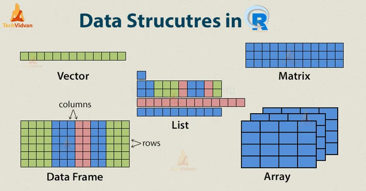
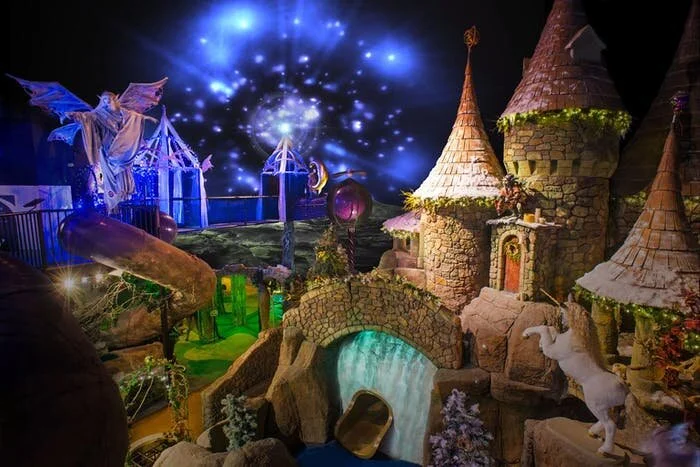

Below is information on my two R packages available on [CRAN](https://cran.r-project.org/). R is open-source statistical software used for data analysis all over the world (<https://www.r-project.org/>). In addition to its base packages, R allows for add-on packages - written by users like me (or you!) - to enhance its software capabilities. There are currently over 25,000 R packages available on CRAN, written by data analysts from dozens of countries.

::: {layout-ncol=2}

::: {#left-str2str}

## str2str

### Convert R Objects from One Structure to Another



Offers a suite of functions for converting to and from (atomic) vectors, matrices, data.frames, and (3D+) arrays as well as lists of these objects. It is an alternative to the base R as.<str>.<method>() functions (e.g., as.data.frame.array()) that provides more useful and/or flexible restructuring of R objects. To do so, it only works with common structuring of R objects (e.g., data.frames with only atomic vector columns).

```{=html}
<div  style="margin: 30px; text-align: center;">
<a class="btn btn-primary" href="https://cran.r-project.org/web/packages/str2str/index.html" role="button" target="_blank" style="padding: 15px 30px;">str2str CRAN webpage</a>
</div>
```

:::

::: {#right-quest}

## quest

### Prepare Questionnaire Data for Analysis



Offers a suite of functions to prepare questionnaire data for analysis (perhaps other types of data as well). By data preparation, I mean data analytic tasks to get your raw data ready for statistical modeling (e.g., regression). There are functions to investigate missing data, reshape data, validate responses, recode variables, score questionnaires, center variables, aggregate by groups, shift scores (i.e., leads or lags), etc. It provides functions for both single level and multilevel (i.e., grouped) data.

```{=html}
<div  style="margin: 30px; text-align: center;">
<a class="btn btn-primary" href="https://cran.r-project.org/web/packages/quest/index.html" role="button" target="_blank" style="padding: 15px 30px;">quest CRAN webpage</a>
</div>
```

:::

:::

